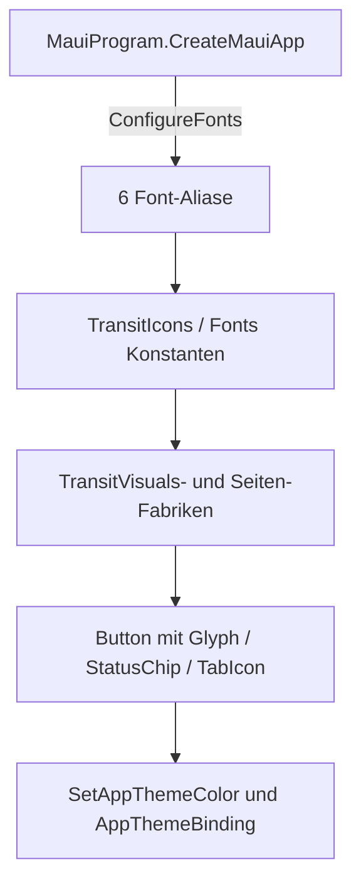

← [Zurück zur Übersicht](index.md)

# Design — Technischer Ablauf

## Übersicht

Der Refresh arbeitet auf drei Ebenen: eingebettete Schrift-Assets (registriert beim App-Start), zentrale Icon-/Visual-Helfer (`TransitIcons`, `Fonts`, `TransitVisuals`) und die prozeduralen Karten/Seiten, die diese Helfer konsumieren. ViewModels, Provider und Datenlogik bleiben unberührt.

## Font- und Icon-Registrierung beim App-Start

1. `FlowNRW.csproj` bindet alle TTFs über `MauiFont Include="Resources\Fonts\*"` ein; neue Dateien benötigen keinen Projekt-Eintrag.
2. `MauiProgram.CreateMauiApp` → `ConfigureFonts` registriert `Inter-Regular.ttf` (`Fonts.Inter`), `Inter-SemiBold.ttf` (`Fonts.InterSemiBold`), `Inter-Bold.ttf` (`Fonts.InterBold`), `JetBrainsMono-Bold.ttf` (`Fonts.JetBrainsMono`), `MaterialSymbolsRounded.ttf` (`TransitIcons.FontFamily` = `"MaterialSymbols"`) und `MaterialSymbolsRoundedFill.ttf` (`TransitIcons.FilledFontFamily` = `"MaterialSymbolsFilled"`).
3. `App.xaml` lädt unverändert `Colors.xaml` + `Styles.xaml`; die impliziten Styles (`Label`, `Button`, `Entry`, `Editor`, `Picker`, `SearchBar`, `DatePicker`, `TimePicker`, `CheckBox`, `RadioButton`) setzen `FontFamily="Inter"`.

## Icon-Auflösung

1. Aufrufer übergeben eine `TransitIcons`-Konstante (z. B. `TransitIcons.Refresh`) statt eines Unicode-Literals. `TransitVisuals.SecondaryAction` erzeugt einen `Button` 48×48 und setzt Glyph, `FontFamily`, `FontSize` 24, `Padding = 0` und die Sprachbeschreibung über `TransitIcons.SetIcon` — `AutomationId` und `SemanticProperties.Description` bleiben unverändert vergeben.
2. `TransitVisuals.ApplyRoles` färbt Sekundär-Buttons weiterhin (`GroupStrong`-Fläche, `Action`-Textfarbe); die Iconfarbe ist die `TextColor` und folgt dem Thema.
3. Dynamische Zustandswechsel laufen über `TransitIcons.SetIcon` plus Beschreibung: `Search`↔`Check` in `SearchPage.Endpoint` (Koordinatenmodus), `ExpandMore`↔`ExpandLess` in `HomePage.BuildCardActions`, `StarOutline`↔`Star` in `DeparturePage.RefreshFavorite` und `ResultsPage.RenderConnectionHeader`. Der gefüllte Zustand nutzt `filled: true` → `FilledFontFamily` (FILL1-Instanz, gleicher Codepoint U+F09A).
4. Buttons mit Icon und sichtbarem Text erhalten das Symbol über `TransitIcons.IconImage` als `FontImageSource` in `Button.ImageSource` (Schrift des Texts bleibt Inter); `TransitIcons.TabIcon` liefert das 24er-`FontImageSource` für die drei Shell-Tabs in `AppShell`.
5. Inline-Symbole außerhalb von Buttons erzeugt `TransitVisuals.IconLabel`; `TransitVisuals.StatusChip` kombiniert Icon- und Text-`Label` in einer `RoundRectangle`-Kapsel mit transluzenter Semantik-Hintergrundfarbe.

## Statusableitung und Karten-Rendering

1. `HomePage.RenderCards`/`DeparturePage.RenderItems` erzeugen `DepartureCardView` wie bisher (max. fünf Einträge je Favoritenkarte).
2. `DepartureCardView` ruft `DeparturePresentation.Status(item)` auf: `Cancelled` → `StatusChip(TransitIcons.Cancel, "Fahrt fällt aus", Error, ErrorDark)` und durchgestrichene Hauptzeit; `Delayed` mit `DelayText` → `StatusChip(TransitIcons.Schedule, "+n Min.", Warning, WarningDark)` neben `TransitVisuals.StrikethroughTime` der Sollzeit; `Scheduled` → `Secondary("Keine Echtzeitdaten")`. Die Hauptzeit läuft in `Fonts.JetBrainsMono` (18, bold); Uhrzeiten formatiert `JourneyPresentation.Clock` in Europe/Berlin.
3. `JourneyCardView` rendert „Ausfall gemeldet" als `StatusChip(TransitIcons.Error, ...)`, sobald ein Abschnitt `Cancelled` meldet; `JourneyTimelineView.Event` analog für „Fahrt fällt aus" je Ereignis.
4. Gleis/Steig-Texte und `SemanticProperties.Description` = `DeparturePresentation.Describe(item)` bleiben unverändert.

## Theme-Wechsel

`UserAppTheme`-Wechsel (System oder `FLOWNRW_UI_TEST_THEME` im `UiTest`-Build) löst die vorhandenen `AppThemeBinding`s/`SetAppThemeColor`s neu auf; Glyph-`TextColor` und `FontImageSource.Color` färben automatisch mit. Es gibt keinen neuen Theme-Mechanismus.

## Windows-spezifische Anpassungen

`FlowNRW/Platforms/Windows/App.xaml` überschreibt die Theme-Margins `NavigationViewItemButtonMargin` und `TopNavigationViewItemContentPresenterMargin` sowie das `TabBarNavigationViewMenuItem`-`DataTemplate` (Schriftgröße 13, gleiche Bindings wie das MAUI-Standardtemplate). Ohne diese Verdichtung schieben die Icon-Tabs den dritten Tab bei der verifizierten 430-px-Breite in das „Mehr"-Überlaufmenü. Alle drei Tabs bleiben als `TabItem` per `SelectionItemPattern` selektierbar.

## Fehlerbehandlung

- **Fehlende Echtzeit:** `DepartureStatus.Scheduled` erzeugt nur den Text „Keine Echtzeitdaten" — kein Chip, keine Pünktlichkeitsbehauptung.
- **Font-Alias falsch/fehlend:** MAUI fällt still auf die Systemschrift zurück (Glyph erscheint als Kästchen); die zentralen Konstanten in `Fonts`/`TransitIcons` machen Tippfehler zum Kompilierfehler — siehe [Fehlerhilfe](troubleshooting.md).
- **Icon-Clipping bei 150 % Textskalierung:** `SetIcon` setzt `Padding = 0`; der `UiTest`-Skalierungspfad in `App.xaml.cs` multipliziert die Glyph-`FontSize` auf 36, was in den 48×48-Buttons vollständig rendert (Nachweis: `*-150-*`-Bilder der [Icon-Matrix](verification/icon-matrix-run.md)).
- **Beschreibung vergessen:** `SetIcon` akzeptiert die `SemanticProperties`-Beschreibung im selben Aufruf, damit Glyph- und Sprachzustand nicht auseinanderlaufen.
